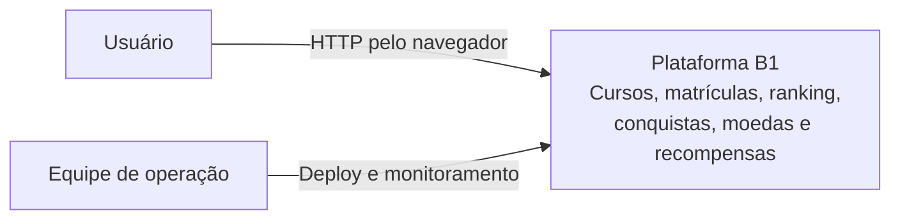
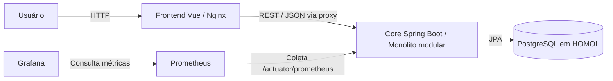
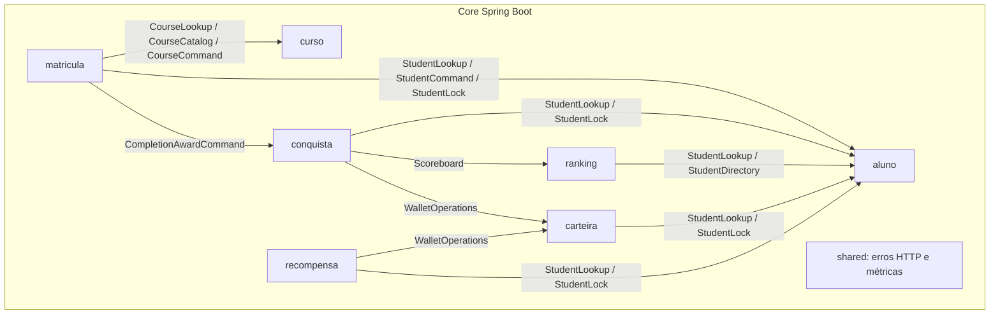
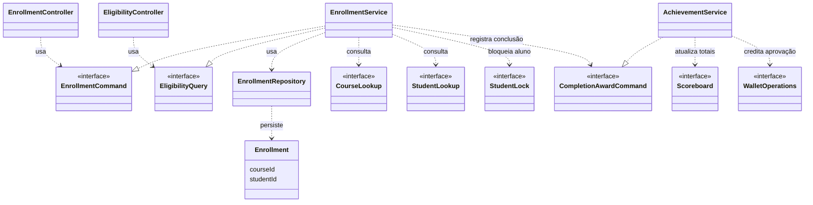

# AC2 / B1 — Evolução do Core e gamificação integrada

## Estado e decisão

O Core evoluiu da AC1 para um **monólito modular: um único processo Spring Boot e uma unidade de deploy do backend**. Os módulos atuais são `curso`, `aluno`, `matricula`, `ranking`, `conquista`, `carteira` e `recompensa`, com recursos comuns em `shared`. A decisão arquitetural está na [ADR-001](docs/arquitetura/ADR-001.md).

Ranking, conquistas, moedas e recompensas estão implementados no backend e integrados ao painel Vue. O ambiente também contém frontend, PostgreSQL, Prometheus e Grafana como serviços separados no Docker Compose.

### Funcionalidades implementadas

- Área de aprendizagem com cursos, matrículas, conclusão e elegibilidade para cursos extras.
- Ranking persistido e indexado, com paginação, pontos em ordem decrescente e desempate pelo ID do aluno em ordem crescente. Há consulta da posição individual; um aluno sem entrada tem pontuação zero e posição nula.
- Pontuação por conclusão calculada por `round(nota × 10)`. A revisão da nota substitui a pontuação daquela matrícula.
- Aprovação com **nota maior que 7** e crédito de **50 moedas**, uma única vez por aluno/curso.
- Três badges: **Primeiro passo** (uma aprovação), **Trilha completa** (três aprovações) e **Excelência** (nota 10). Badges conquistados permanecem registrados; a revisão da nota não remove os badges nem estorna o crédito de aprovação já concedido.
- Carteira com saldo e extrato; catálogo de recompensas, resgate com débito de moedas e histórico. A repetição de uma solicitação com o mesmo identificador não duplica o resgate.

A conclusão chama `CompletionAwardCommand` no módulo `conquista`, que atualiza o progresso, concede badges e moedas e substitui os totais do ranking via `Scoreboard`. Essas operações participam da transação de conclusão. O resgate integra `recompensa` e `carteira` por contratos públicos.

### Contrato HTTP

As rotas e os payloads legados de criação, conclusão e elegibilidade foram preservados. As consultas e funcionalidades de gamificação ampliam a API:

| Método | Rota | Finalidade |
|---|---|---|
| POST | `/courses` | Criar curso |
| GET | `/courses` | Consultar catálogo de cursos |
| POST | `/students` | Criar aluno |
| GET | `/students` | Consultar alunos |
| POST | `/enrollments` | Criar matrícula |
| POST | `/enrollments/{id}/complete` | Concluir matrícula ou revisar sua nota |
| GET | `/students/{id}/eligible-for-extra-courses` | Consultar elegibilidade |
| GET | `/learning-space` | Consultar a área de aprendizagem |
| GET | `/ranking?page=0&size=20` | Consultar ranking paginado; tamanho limitado entre 1 e 100 |
| GET | `/ranking/students/{studentId}` | Consultar pontuação e posição individual |
| GET | `/students/{studentId}/achievements` | Consultar progresso e badges |
| GET | `/students/{studentId}/wallet` | Consultar saldo e extrato |
| GET | `/rewards` | Consultar catálogo de recompensas |
| GET | `/students/{studentId}/redemptions` | Consultar histórico recente de resgates |
| POST | `/students/{studentId}/redemptions` | Resgatar recompensa |

As rotas acima são do backend. O Nginx encaminha as chamadas do frontend com prefixo `/api/` para a API.

### Fronteiras dos módulos

| Módulo | Principais contratos públicos em `api` | Implementação em `internal` |
|---|---|---|
| `curso` | `CourseCommand`, `CourseLookup`, `CourseCatalog`, DTOs e controllers | Serviço, entidade e repository de cursos |
| `aluno` | `StudentCommand`, `StudentLookup`, `StudentDirectory`, `StudentLock`, DTOs e controllers | Serviço, entidade e repository de alunos |
| `matricula` | `EnrollmentCommand`, `EligibilityQuery`, `LearningSpaceQuery`, DTOs e controllers | Matrículas, perfil de aprendizagem e inicialização de dados |
| `ranking` | `RankingQuery`, `Scoreboard`, DTOs e controller | Projeção persistida, ordenação, paginação e posição |
| `conquista` | `CompletionAwardCommand`, `AchievementQuery`, DTOs e controller | Regras de gamificação, progresso e badges |
| `carteira` | `WalletOperations`, `WalletQuery`, DTOs e controller | Créditos, débitos, saldo e extrato |
| `recompensa` | `RewardCommand`, `RewardQuery`, DTOs e controller | Catálogo e persistência dos resgates |
| `shared` | Recursos comuns, sem divisão `api`/`internal` | Erros HTTP e métricas após confirmação da transação |

Controllers dependem de contratos públicos; os serviços internos implementam esses contratos. Nenhuma API importa classes internas, e nenhum módulo acessa o pacote `internal` de outro. O endpoint de elegibilidade pertence a `matricula`; `aluno` não depende desse módulo.

`ModuleBoundariesTest` possui seis testes, incluindo fronteiras entre todos os módulos e ausência de ciclos. `RankingBoundaryTest` complementa a verificação da fronteira do ranking.

## Matriz cumulativa de ASRs

| ASR | Estímulo | Resposta/critério | Evidência atual | Gatilho futuro |
|---|---|---|---|---|
| ASR-01 Manutenibilidade | Nova regra de pontuação ou badge | Regras concentradas no módulo responsável e integração por contratos públicos | `GamificationRules`, seis testes em `ModuleBoundariesTest` e `RankingBoundaryTest` | Reavaliar fronteiras quando uma mudança exigir acoplamento entre módulos |
| ASR-02 Escalabilidade | Crescimento da base e maior acesso ao ranking | Projeção própria, paginação e medição de latência e throughput | Benchmark com 100 mil registros, p95 de 70,886 ms e 262,118 requisições/s em MockMvc + JPA + H2 | Gargalo medido no ambiente real ou necessidade de escala independente |
| ASR-03 Complexidade operacional | Operar o Core com a equipe do cenário | Uma unidade de deploy do backend e uma esteira | Container `app` e `Jenkinsfile` | Necessidade comprovada de deploy independente |

O benchmark é uma medição local sem HTTP externo; não comprova capacidade para 100 mil usuários simultâneos nem desempenho em PostgreSQL/HOMOL. Metas de CPU e demais critérios do enunciado precisam de evidência específica. A equipe real identificada na AC1 tem três integrantes; o enunciado considera seis desenvolvedores como restrição do cenário.

## Matriz de rastreabilidade do DOCX

| Requisito / decisão | Implementação | Validação e estado |
|---|---|---|
| RF01 Ranking | Módulo `ranking`, API paginada, posição individual e painel Vue | `RankingFlowTest`, `RankingBoundaryTest`, `RankingCapacityTest` e Cypress |
| RF02 Conquistas, badges, moedas e recompensas | Módulos `conquista`, `carteira` e `recompensa`, integrados à conclusão | Testes de regras, API e transação; Cypress de gamificação |
| Fluxo US4 matrícula/conclusão/elegibilidade | `EnrollmentService`, `EligibilityController` e contratos públicos | Testes de domínio, HTTP e fluxo; rotas legadas preservadas |
| RNFs e ASRs | Matriz acima | Fronteiras verificadas e benchmark local disponível; carga real permanece como validação adicional |
| RPC Spring Boot e Java | Boot 4.1.1 e Java 21 | Maven, Dockerfile e CI |
| RPC banco relacional e legado AC1 | Tabelas legadas preservadas e esquema ampliado | Testes H2 e scripts SQL de integridade; `validate` exige esquema previamente atualizado |
| Alternativas A/B/C e trade-offs | ADR-001 | Registro da decisão arquitetural |
| Monólito modular | Sete módulos de negócio no container `app` | ArchUnit e Docker Compose |
| Mini-lab antes/depois | Remoção do acesso direto de controllers a repositories | Histórico da primeira etapa e `ModuleBoundariesTest` |
| ADR + C4 | ADR-001 e diagramas abaixo | Correspondência com os módulos atuais |
| Jenkins e observabilidade | Pipeline, Prometheus e dashboards A1/B1 | Etapas de testes, deploy, integridade, E2E isolado e consultas de métricas configuradas |

## Persistência e evolução do esquema

`Enrollment` guarda `courseId` e `studentId` como IDs escalares, preservando as colunas `course_id` e `student_id` e evitando dependências entre entidades internas. `CourseLookup` e `StudentLookup` validam as referências e fornecem os nomes das respostas HTTP.

As tabelas legadas `course`, `student` e `enrollment` foram preservadas, mas o esquema foi ampliado para aprendizagem e gamificação. Os scripts versionados estão em [docs/arquitetura/sql](docs/arquitetura/sql):

| Script | Finalidade |
|---|---|
| `001-ensure-enrollment-fks.sql` | Garantir chaves estrangeiras das matrículas |
| `002-gamification-fks.sql` | Garantir chaves estrangeiras da gamificação |
| `003-achievements-wallet-tables.sql` | Criar tabelas de conquistas e carteira |
| `004-reward-tables.sql` | Criar tabela de resgates |

O pipeline de HOMOL aplica os scripts na ordem **001, 003, 004, 002**, após a inicialização da aplicação. O laboratório usa `ddl-auto=update`. Para usar `SPRING_JPA_HIBERNATE_DDL_AUTO=validate`, prepare previamente o esquema completo exigido pela versão atual; um banco contendo apenas as tabelas da AC1 não basta. Os scripts existentes complementam a criação de esquema pelo Hibernate; não representam, por si só, um sistema completo de migrações.

`HistoricalGamificationBootstrap` processa conclusões antigas em lotes pelo mesmo contrato de concessão usado na conclusão. O processamento é habilitado por padrão e pode ser desativado com `gamification.backfill.enabled=false`.

## Validação reproduzível

Pré-requisitos: JDK 21, Docker Desktop com Compose v2+, Git e acesso a Maven Central/NPM. O wrapper Maven fixa a versão 3.9.16. Copie `.env.example` para `.env` (ignorado pelo Git) e defina `POSTGRES_PASSWORD`, `PGADMIN_DEFAULT_PASSWORD` e `GRAFANA_ADMIN_PASSWORD`. Para reutilizar volumes existentes, mantenha as credenciais atuais.

```powershell
cd backend
./mvnw.cmd -B clean verify pmd:check
cd ..
docker compose -f docker-compose.yml -f docker-compose.homol.yml up -d --build
# API: http://localhost:8080/actuator/health
# Prometheus: http://localhost:9090/targets
# Grafana: http://localhost:3002
```

A subida via Compose não executa as etapas SQL e Cypress do Jenkins automaticamente. Consulte o [Jenkinsfile](Jenkinsfile) para reproduzir essas etapas, incluindo a ordem dos scripts e o ambiente E2E isolado definido em [docker-compose.e2e.yml](docker-compose.e2e.yml).

### Jenkins

O job usa `Pipeline script from SCM`, o repositório `dev_ops_ex_A1`, a branch desejada e o `Jenkinsfile` na raiz. O agente precisa de JDK 21 no `PATH`, Git, Docker Engine/Compose, `curl`, acesso a Maven Central/NPM e permissão para controlar Docker. Plugins: Pipeline, Git, Credentials Binding, JUnit e Coverage.

| Credencial Secret text | Uso |
|---|---|
| `b1-postgres-password` | PostgreSQL e API HOMOL |
| `b1-pgadmin-password` | pgAdmin |
| `b1-grafana-admin-password` | Grafana e validação autenticada |

O pipeline executa build, testes, JaCoCo, PMD, empacotamento, build dos containers, deploy, health check, scripts SQL, Cypress e observabilidade. Publica JUnit, relatórios JaCoCo/PMD, JAR e artefatos disponíveis do Cypress.

O Cypress usa um projeto Compose separado por build, com banco descartável. O container de testes usa `run --rm`; ao final, os serviços e volumes desse projeto E2E são removidos. Os serviços e volumes de HOMOL permanecem.

A observabilidade valida o target `app:8080` no job Prometheus `jogo-enigma-api`, a série `up=1`, o datasource e os dashboards `a1-observabilidade-homol` e `b1-gamificacao`. O nome do job Prometheus foi mantido por compatibilidade. O job Freestyle anterior não representa esta cadeia completa.

Antes de mudanças de esquema, faça backup do PostgreSQL e dos volumes de observabilidade. Um retorno a uma versão anterior da aplicação exige verificar a compatibilidade com o esquema e os dados atuais. A senha do PostgreSQL persistida não muda apenas pela alteração da variável de ambiente.

## Evidências e limites

Os registros da [parte 4](docs/evidencias/parte4) contêm:

- [Backend](docs/evidencias/parte4/validacao-backend.txt): **70 testes, zero falhas e erros**, com `BUILD SUCCESS` e verificação PMD.
- [Cypress](docs/evidencias/parte4/cypress.txt): **5 cenários aprovados**, sendo dois da área de aprendizagem e três de gamificação.
- [Build do frontend](docs/evidencias/parte4/build-frontend.txt) e [captura mobile](docs/evidencias/parte4/painel-mobile.png).
- [Benchmark do ranking](docs/evidencias/parte4/ranking-benchmark.json): 100 mil registros, 160 requisições, concorrência 8, p95 de **70,886 ms**, **262,118 requisições/s** e três consultas SQL por página.

São evidências de execuções registradas no repositório, não uma nova execução feita durante esta revisão documental. O benchmark usa **MockMvc + JPA + H2 isolado, sem HTTP externo**. Resultados de produção, carga externa em HOMOL e uma execução recente do job Jenkins não são comprovados por esses arquivos.

O histórico da primeira etapa, incluindo os números anteriores de testes e verificações de observabilidade, permanece em [evidencias.md](docs/arquitetura/evidencias.md). Esses números não representam a suíte integrada atual.

## Diagramas C4

Os diagramas representam o estado integrado do Core. As dependências entre módulos usam contratos públicos. A decisão de manter um único processo Spring Boot continua alinhada à [ADR-001](docs/arquitetura/ADR-001.md).

### Nível 1 — Context



O usuário acessa a área de aprendizagem e a gamificação. A equipe opera o pipeline e os dashboards. O ambiente entregue usa HTTP; não há configuração TLS no Nginx do projeto nem integração com terceiros para executar as recompensas.

### Nível 2 — Containers



| Container | Responsabilidade |
|---|---|
| Frontend | Área de aprendizagem e painel de ranking, conquistas, carteira e recompensas |
| Core | Regras dos sete módulos em uma unidade de deploy Java 21 / Spring Boot |
| PostgreSQL | Persistência de HOMOL; desenvolvimento e testes usam H2 |
| Prometheus | Coleta de métricas do Core em `app:8080` |
| Grafana | Dashboards A1 de observabilidade e B1 de gamificação |

A unidade de deploy do backend reduz a complexidade operacional, mas impede escalar seus módulos de forma independente. O ranking já tem fronteira própria e benchmark local; uma extração futura exige evidência de gargalo ou necessidade de deploy independente.

### Nível 3 — Components

O diagrama resume as dependências entre módulos de negócio. Cada seta significa uso de **contratos do pacote `api` do destino**, nunca acesso ao `internal` de outro módulo.



Dentro de cada módulo, controllers usam contratos públicos e serviços internos os implementam. `shared` fornece recursos comuns; suas ligações foram omitidas para simplificar o diagrama. As fronteiras e a ausência de ciclos são verificadas por ArchUnit.

### Nível 4 — Code: conclusão de matrícula

Este recorte mostra os contratos usados pelo serviço de matrícula e sua integração com a gamificação. Os demais módulos também possuem dependências entre contratos públicos.



`EnrollmentService` preserva os contratos legados e chama conquistas durante a conclusão. `AchievementService` concentra o processamento de progresso e concessões. Os testes de API, regras e transação verificam os fluxos integrados, incluindo a repetição de operações sem duplicar moedas ou resgates.
