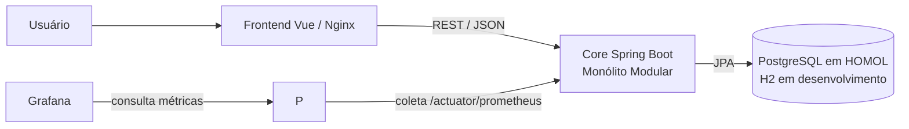
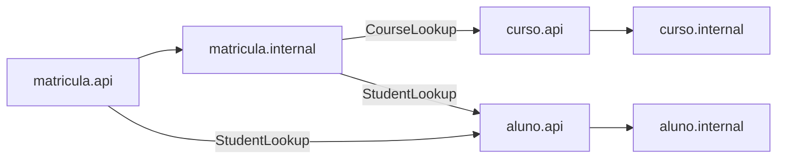
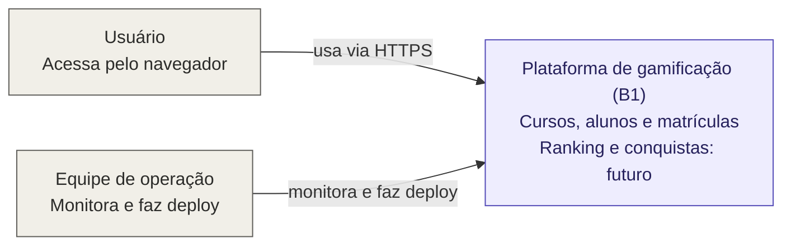
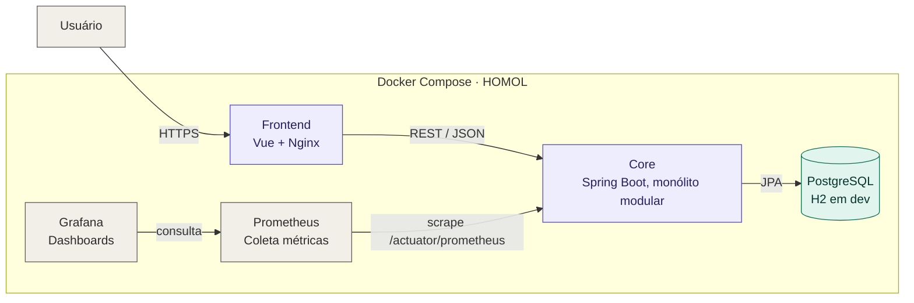
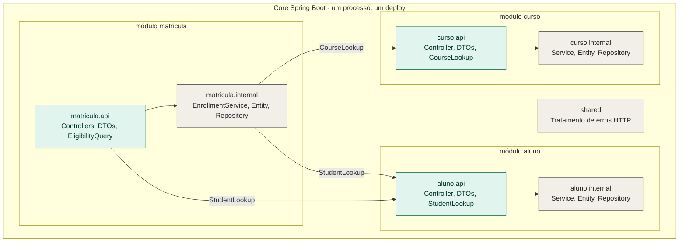
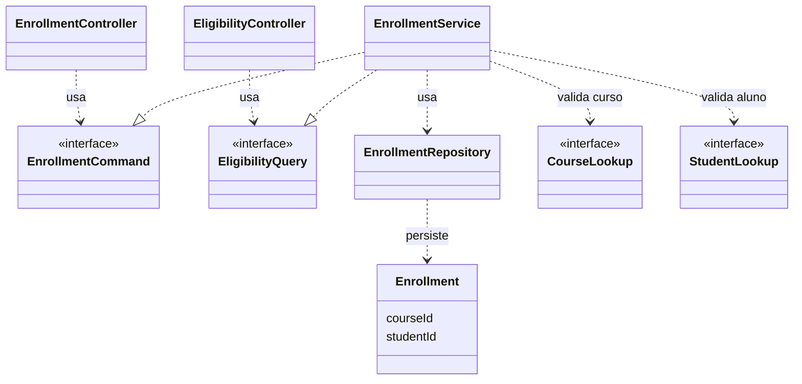

# B1 — Desafio 1: drivers e evolução do Core

## Estado e decisão

O Core da AC1 foi reorganizado de pacotes por camada técnica para os módulos `curso`, `aluno` e `matricula`. Ele continua sendo **um único processo Spring Boot e um único deploy**. A decisão ADR-001 está em [ADR-001.md](docs/arquitetura/ADR-001.md). Ranking, Conquistas, Moedas e Recompensas são capacidades futuras do case B1; não são funcionalidades da AC1 implementadas neste desafio.

O contrato HTTP continua: `POST /courses`, `POST /students`, `POST /enrollments`, `POST /enrollments/{id}/complete` e `GET /students/{id}/eligible-for-extra-courses`. As tabelas `course`, `student` e `enrollment`, inclusive `course_id` e `student_id`, mantêm nomes e tipos. A entidade `Enrollment` passou a guardar esses IDs em vez de depender das entidades internas de outros módulos. Na instalação existente, as chaves estrangeiras do PostgreSQL permanecem no banco. A aplicação valida as referências por `CourseLookup` e `StudentLookup` antes de criar matrículas. Não há alteração de payload nem migração destrutiva de dados.

## Entrega da parte 2 Ranking

Branch `codex/b1-parte2-ranking`, baseada na parte 1. O commit adicional implementa somente Ranking: projeção persistida e indexada, paginação, desempate por ID, posição individual e painel lateral. Pontos = nota × 10; a revisão da nota substitui os pontos. Matrícula atualiza o ranking pela API Scoreboard na mesma transação. O backfill reconstrói os totais das conclusões antigas; `ranking.backfill.enabled=false` o desativa.

Moedas, badges, conquistas e recompensas não estão incluídos. A outra pessoa poderá integrar esses módulos depois pelo contrato Scoreboard, substituindo o atual adaptador EnrollmentRankingUpdater. A versão completa original continua preservada localmente.

## Entrega da parte 1 Área do aluno e cursos

| Módulo | API/contrato | Implementação interna |
|---|---|---|
| `curso` | Controller, DTOs, `CourseLookup`/`CourseView` | Entity, repository, service |
| `aluno` | Controller, DTOs, `StudentLookup`/`StudentView` | Entity, repository, service |
| `matricula` | Controllers, DTOs, `EligibilityQuery` | Entity, repository, `EnrollmentService` |
| `shared` | Tratamento de erros HTTP | — |

O endpoint de elegibilidade permanece na mesma URL, mas agora pertence ao controller de `matricula`. Assim, `aluno` não depende de `matricula`; `matricula` usa apenas as APIs públicas de `curso` e `aluno`. Os controllers dependem de contratos `Command`/`Query` e os DTOs não importam entidades internas. O teste `ModuleBoundariesTest` impede acesso de controllers a repositories, dependências de `api` a `internal` e dependências de um módulo ao pacote `internal` de outro.

### C4 Container





As últimas ligações usam contratos dos pacotes `api`; não apontam para classes `internal` de outro módulo.

## Matriz cumulativa de ASRs — Desafio 1

| ASR | Estímulo | Resposta/critério | Evidência atual | Gatilho futuro |
|---|---|---|---|---|
| ASR-01 Manutenibilidade | Nova regra de pontuação ou badge | Mudança confinada ao módulo responsável e seu contrato; zero dependências entre módulos internos | Pacotes por capacidade e quatro testes de arquitetura passando | Uma mudança real que exigir vários módulos altera a decisão |
| ASR-02 Escalabilidade | Crescimento de 1.000 para até 100.000 usuários, com Ranking mais acessado | Fronteira própria para Ranking; medir p95 e throughput sob carga | Fronteiras do Core preparadas; Ranking ainda não implementado, sem baseline | Gargalo medido ou necessidade de escala própria |
| ASR-03 Complexidade operacional | Equipe do cenário precisa operar o Core | Uma unidade de deploy e uma esteira | Um container `app` e um Jenkinsfile | Necessidade comprovada de deploy independente |

As metas de p95, throughput, CPU e módulos alterados no DOCX são **propostas de validação**, não resultados medidos. A equipe real identificada na AC1 tem três integrantes; o enunciado do desafio considera uma equipe de seis desenvolvedores como restrição do cenário.

## Matriz de rastreabilidade do DOCX

| Requisito / decisão | Implementação | Validação e estado |
|---|---|---|
| RF01 Ranking | Fronteira futura registrada na ADR e no C4; nenhuma API de Ranking foi solicitada para o mini-lab da AC1 | Planejado para desafio posterior; medições indisponíveis até existir o endpoint |
| RF02 Conquistas, badges, moedas e recompensas | Fronteiras futuras na ADR, sem implementação fictícia | Planejado para desafio posterior |
| Fluxo existente US4 matrícula/conclusão/elegibilidade | `matricula.internal.EnrollmentService`, `EligibilityController`, entidades e contratos `curso.api`/`aluno.api` | Testes de domínio, HTTP e fluxo completo; respostas e rotas preservadas |
| RNFs e até três ASRs | Matriz cumulativa acima | Manutenibilidade e custo operacional verificados estruturalmente; escalabilidade depende de carga real |
| RPC Spring Boot e Java | Boot 4.1.1, Java 21 no pom, Dockerfile e CI | `mvn clean verify`, build Docker |
| RPC banco relacional e legado AC1 | H2 nos testes; PostgreSQL HOMOL; mesmas tabelas e colunas | Testes H2 e validação `ddl-auto=validate` no PostgreSQL existente |
| Alternativas A/B/C e trade-offs | ADR-001 | Revisão da decisão e dos custos explícitos |
| Decisão Monólito Modular, um deploy | `curso`, `aluno`, `matricula`, container `app` | ArchUnit e Docker Compose |
| Mini-lab antes/depois | Antes: 3 controllers com repository; depois: 0; regra de elegibilidade no módulo `matricula` | `ModuleBoundariesTest` e `EnrollmentControllerTest` |
| ADR + C4 | ADR-001 e diagramas acima | Conferência com código e Compose |
| Jenkins e observabilidade preservados | Jenkinsfile, Prometheus `app:8080`, datasource e dashboard Grafana | `mvn`, Docker/Cypress, target UP e consulta no Grafana; execução do job depende das credenciais Jenkins abaixo |

**Adaptação técnica:** o DOCX mostra uma estrutura proposta com `Enrollment` ligado a `Course` e `Student`. Os IDs escalares preservam as colunas persistidas e evitam que `matricula.internal` importe entidades internas dos outros módulos. Os nomes de curso e aluno da resposta HTTP vêm de `CourseLookup` e `StudentLookup`.

## Validação reproduzível

Pré-requisitos locais: JDK 21, Docker Desktop com Compose v2+, Git e acesso a Maven Central/NPM. O wrapper Maven fixa a distribuição 3.9.16. Copie `.env.example` para `.env` (ignorado pelo Git) e defina `POSTGRES_PASSWORD`, `PGADMIN_DEFAULT_PASSWORD` e `GRAFANA_ADMIN_PASSWORD`. Em uma instalação existente, mantenha os valores atuais para reutilizar os volumes PostgreSQL/pgAdmin/Grafana. Não coloque senhas em commits ou relatórios.

```powershell
cd backend
./mvnw.cmd -B clean verify pmd:check
cd ..
docker compose -f docker-compose.yml -f docker-compose.homol.yml up -d --build
# API: http://localhost:8080/actuator/health
# Prometheus: http://localhost:9090/targets (job jogo-enigma-api, instance app:8080, UP)
# Grafana: http://localhost:3002
```

Para verificar a preservação do esquema em um PostgreSQL já utilizado, suba a nova aplicação em outra porta com `SPRING_JPA_HIBERNATE_DDL_AUTO=validate`. Se o banco for novo, o laboratório continua usando `ddl-auto=update`; o serviço valida IDs antes de gravar. Antes de um ambiente não acadêmico, versionar migrações SQL e substituir `update` por `validate` é recomendado.

### Jenkins

O job Pipeline usa `Pipeline script from SCM`, repositório `dev_ops_ex_A1`, branch desejada e `Jenkinsfile` na raiz. O agente precisa de JDK 21 no `PATH`, Git, Docker Engine/Compose, `curl`, acesso de rede a Maven Central e NPM e permissão para controlar Docker. Plugins: Pipeline, Git, Credentials Binding, JUnit e Coverage. O `Jenkinsfile` usa três credenciais **Secret text** do Jenkins:

| ID no Jenkins | Uso |
|---|---|
| `b1-postgres-password` | PostgreSQL e API HOMOL |
| `b1-pgadmin-password` | pgAdmin |
| `b1-grafana-admin-password` | Grafana e consulta autenticada na validação |

Defina-as com os mesmos valores dos serviços existentes antes de executar o job sobre os volumes atuais. O pipeline publica JUnit, JaCoCo, PMD e o JAR; falha em teste, fronteira, PMD, build, health, Cypress ou coleta/consulta de métricas e dashboard. O container temporário Cypress é removido com `run --rm`; os serviços de homologação e seus volumes permanecem por serem o ambiente entregue. O `POSTGRES_PASSWORD` não pode mudar sem alterar também a senha do usuário persistida no banco. Para recuperar o deploy anterior, retorne ao commit anterior e execute o Compose com as mesmas credenciais e volumes; antes de qualquer migração de dados, faça backup do PostgreSQL com `pg_dump` e guarde uma cópia dos volumes do Grafana e do Prometheus. A migração `001-ensure-enrollment-fks.sql` só adiciona chaves ausentes e pode ser reaplicada.

O job A2 Freestyle anterior não executa esta cadeia completa; a referência de validação B1 é o Pipeline. O nome Prometheus `jogo-enigma-api` foi mantido para compatibilidade com o dashboard A2, mas seu alvo real é `app:8080` do projeto A1.

## Evidências e limites

Antes do refactor, os três controllers injetavam repositories, e a suíte local tinha 37 testes. Depois, nenhum controller injeta repository; ArchUnit verifica essa propriedade. A execução local desta revisão teve 42 testes aprovados, zero violação PMD, build dos containers e dois cenários Cypress aprovados. O alvo Prometheus ficou `UP`, o Grafana consultou a série `up=1` e o dashboard A1 foi encontrado. Os comandos e limites estão em [evidencias.md](docs/arquitetura/evidencias.md). Não foi executado teste de carga de Ranking, pois o recurso ainda não existe. A execução do job Jenkins desta revisão continua pendente até a configuração das credenciais e o acesso ao navegador; o ADR permanece proposto quanto à validação de escala futura.

## Diagramas C4

O modelo C4 descreve a arquitetura em quatro níveis de zoom: **Context** (o sistema no seu ambiente), **Containers** (as unidades executáveis), **Components** (a estrutura interna de um container) e **Code** (as classes de um componente). Aqui os quatro níveis documentam o Core do B1 conforme a decisão da [ADR-001](docs/arquitetura/ADR-001.md): monólito modular, um único processo Spring Boot e um único deploy.

Os níveis 1 a 3 usam `flowchart` e o nível 4 usa `classDiagram`, ambos renderizados nativamente pelo GitHub.

---

### Nível 1 — Context

**O que mostra:** o sistema como uma caixa única, quem interage com ele e o que ele entrega. Não há detalhes técnicos neste nível; ele serve para alinhar o escopo.



| Elemento | Tipo | Responsabilidade |
|---|---|---|
| Usuário | Pessoa | Usa a plataforma pelo navegador para gerenciar cursos, alunos e matrículas. |
| Equipe de operação | Pessoa | Faz o deploy (pipeline Jenkins) e acompanha métricas e dashboards (Prometheus/Grafana). |
| Plataforma de gamificação (B1) | Sistema | Entrega hoje o fluxo herdado da AC1: cursos, alunos, matrícula, conclusão e elegibilidade para cursos extras. |

**Pontos de atenção**

- Ranking, Conquistas, Moedas e Recompensas são capacidades **futuras** do case B1. Aparecem no diagrama apenas como intenção; não há implementação nem API para elas neste desafio.
- Não há sistemas externos no escopo atual, então o diagrama não mostra integrações de terceiros.

---

### Nível 2 — Containers

**O que mostra:** as unidades executáveis e de dados que compõem a plataforma, a tecnologia de cada uma e como elas se comunicam.



| Container | Tecnologia | Responsabilidade |
|---|---|---|
| Frontend | Vue + Nginx | Interface web; consome a API do Core por REST/JSON. |
| Core | Spring Boot (Java 21) | Concentra as regras de negócio em módulos (`curso`, `aluno`, `matricula`). É um único processo e um único deploy. |
| PostgreSQL | PostgreSQL (HOMOL), H2 (desenvolvimento e testes) | Persistência via JPA. Tabelas `course`, `student` e `enrollment` preservadas, inclusive nomes e tipos de `course_id` e `student_id`. |
| Prometheus | Prometheus | Coleta métricas do Core em `/actuator/prometheus`. O job se chama `jogo-enigma-api` por compatibilidade com o dashboard A2; o alvo real é `app:8080`. |
| Grafana | Grafana | Consulta o Prometheus e exibe o dashboard do A1. |

**Decisões e trade-offs (ADR-001)**

- **Um deploy só:** atende o ASR-03 (complexidade operacional): um container `app` e um `Jenkinsfile`. O custo é não poder escalar partes do sistema de forma independente.
- **Escalabilidade (ASR-02):** as fronteiras internas já preparam um futuro Ranking separado, mas ele ainda não existe e não há baseline de carga. A decisão só muda diante de gargalo medido ou necessidade comprovada de deploy independente.
- Prometheus e Grafana fazem parte do ambiente de homologação entregue e permanecem após o pipeline.

---

### Nível 3 — Components

**O que mostra:** a estrutura interna do container Core: os módulos por capacidade de negócio, o que cada um expõe (`api`) e o que esconde (`internal`), e quem depende de quem.



| Módulo | `api` (contrato público) | `internal` (implementação) |
|---|---|---|
| `curso` | Controller, DTOs, `CourseLookup` / `CourseView` | Entity, repository, service |
| `aluno` | Controller, DTOs, `StudentLookup` / `StudentView` | Entity, repository, service |
| `matricula` | Controllers, DTOs, `EligibilityQuery` | Entity, repository, `EnrollmentService` |
| `shared` | — | Tratamento de erros HTTP |

**Regras de dependência**

- `matricula` usa apenas as APIs públicas de `curso` e `aluno`. Nenhuma seta aponta para o `internal` de outro módulo.
- `aluno` **não** depende de `matricula`: o endpoint `GET /students/{id}/eligible-for-extra-courses` mantém a mesma URL, mas agora pertence ao controller de `matricula`.
- Controllers não acessam repositories e as `api` não importam classes `internal`.

**Evidência (ASR-01, manutenibilidade):** o `ModuleBoundariesTest` (ArchUnit) verifica essas regras automaticamente. Antes do refactor, 3 controllers injetavam repositories; depois, nenhum injeta.

---

### Nível 4 — Code (módulo `matricula`)

**O que mostra:** as classes e interfaces do módulo `matricula`, o ponto onde o Core cruza fronteiras entre módulos. É o único módulo detalhado neste nível porque é ele que concentra as dependências de `curso` e `aluno`.



| Classe | Camada | Papel |
|---|---|---|
| `EnrollmentController` | `matricula.api` | Expõe `POST /enrollments` e `POST /enrollments/{id}/complete`. |
| `EligibilityController` | `matricula.api` | Expõe `GET /students/{id}/eligible-for-extra-courses`. |
| `EnrollmentCommand` / `EligibilityQuery` | `matricula.api` | Contratos Command/Query: os controllers dependem deles, não do service. |
| `EnrollmentService` | `matricula.internal` | Implementa os contratos e concentra a regra de matrícula, conclusão e elegibilidade. |
| `EnrollmentRepository` | `matricula.internal` | Persistência de `Enrollment`. |
| `Enrollment` | `matricula.internal` | Guarda `courseId` e `studentId` como IDs, em vez de referenciar as entidades internas de `curso` e `aluno`. |
| `CourseLookup` / `StudentLookup` | `curso.api` / `aluno.api` | Contratos de consulta usados para validar as referências antes de criar a matrícula e para obter os nomes exibidos na resposta HTTP. |

**Decisões de código**

- Os IDs escalares em `Enrollment` preservam as colunas `course_id` e `student_id` e evitam que `matricula.internal` importe entidades de outros módulos. As chaves estrangeiras continuam no PostgreSQL; a aplicação valida as referências por `CourseLookup` e `StudentLookup`.
- Não há alteração de payload nem migração destrutiva: o contrato HTTP e as tabelas da AC1 permanecem como estavam.
- Os fluxos de matrícula, conclusão e elegibilidade são cobertos por testes de domínio, HTTP e fluxo completo (por exemplo, `EnrollmentControllerTest`).
