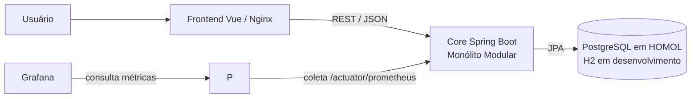
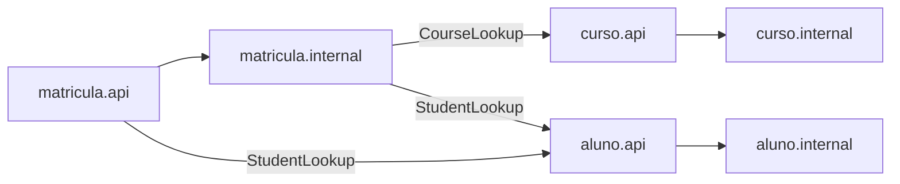

# B1 — Desafio 1: drivers e evolução do Core

## Estado e decisão

O Core da AC1 foi reorganizado de pacotes por camada técnica para os módulos `curso`, `aluno` e `matricula`. Ele continua sendo **um único processo Spring Boot e um único deploy**. A decisão ADR-001 está em [ADR-001.md](ADR-001.md). Ranking, Conquistas, Moedas e Recompensas são capacidades futuras do case B1; não são funcionalidades da AC1 implementadas neste desafio.

O contrato HTTP continua: `POST /courses`, `POST /students`, `POST /enrollments`, `POST /enrollments/{id}/complete` e `GET /students/{id}/eligible-for-extra-courses`. As tabelas `course`, `student` e `enrollment`, inclusive `course_id` e `student_id`, mantêm nomes e tipos. A entidade `Enrollment` passou a guardar esses IDs em vez de depender das entidades internas de outros módulos. Na instalação existente, as chaves estrangeiras do PostgreSQL permanecem no banco. A aplicação valida as referências por `CourseLookup` e `StudentLookup` antes de criar matrículas. Não há alteração de payload nem migração destrutiva de dados.

### Fronteiras dos módulos

| Módulo | API/contrato | Implementação interna |
|---|---|---|
| `curso` | Controller, DTOs, `CourseLookup`/`CourseView` | Entity, repository, service |
| `aluno` | Controller, DTOs, `StudentLookup`/`StudentView` | Entity, repository, service |
| `matricula` | Controllers, DTOs, `EligibilityQuery` | Entity, repository, `EnrollmentService` |
| `shared` | Tratamento de erros HTTP | — |

O endpoint de elegibilidade permanece na mesma URL, mas agora pertence ao controller de `matricula`. Assim, `aluno` não depende de `matricula`; `matricula` usa apenas as APIs públicas de `curso` e `aluno`. Os controllers dependem de contratos `Command`/`Query` e os DTOs não importam entidades internas. O teste `ModuleBoundariesTest` impede acesso de controllers a repositories, dependências de `api` a `internal` e dependências de um módulo ao pacote `internal` de outro.

### C4 Container





As últimas ligações usam contratos dos pacotes `api`; não apontam para classes `internal` de outro módulo.

## Matriz cumulativa de ASRs — Desafio 1

| ASR | Estímulo | Resposta/critério | Evidência atual | Gatilho futuro |
|---|---|---|---|---|
| ASR-01 Manutenibilidade | Nova regra de pontuação ou badge | Mudança confinada ao módulo responsável e seu contrato; zero dependências entre módulos internos | Pacotes por capacidade e quatro testes de arquitetura passando | Uma mudança real que exigir vários módulos altera a decisão |
| ASR-02 Escalabilidade | Crescimento de 1.000 para até 100.000 usuários, com Ranking mais acessado | Fronteira própria para Ranking; medir p95 e throughput sob carga | Fronteiras do Core preparadas; Ranking ainda não implementado, sem baseline | Gargalo medido ou necessidade de escala própria |
| ASR-03 Complexidade operacional | Equipe do cenário precisa operar o Core | Uma unidade de deploy e uma esteira | Um container `app` e um Jenkinsfile | Necessidade comprovada de deploy independente |

As metas de p95, throughput, CPU e módulos alterados no DOCX são **propostas de validação**, não resultados medidos. A equipe real identificada na AC1 tem três integrantes; o enunciado do desafio considera uma equipe de seis desenvolvedores como restrição do cenário.

## Matriz de rastreabilidade do DOCX

| Requisito / decisão | Implementação | Validação e estado |
|---|---|---|
| RF01 Ranking | Fronteira futura registrada na ADR e no C4; nenhuma API de Ranking foi solicitada para o mini-lab da AC1 | Planejado para desafio posterior; medições indisponíveis até existir o endpoint |
| RF02 Conquistas, badges, moedas e recompensas | Fronteiras futuras na ADR, sem implementação fictícia | Planejado para desafio posterior |
| Fluxo existente US4 matrícula/conclusão/elegibilidade | `matricula.internal.EnrollmentService`, `EligibilityController`, entidades e contratos `curso.api`/`aluno.api` | Testes de domínio, HTTP e fluxo completo; respostas e rotas preservadas |
| RNFs e até três ASRs | Matriz cumulativa acima | Manutenibilidade e custo operacional verificados estruturalmente; escalabilidade depende de carga real |
| RPC Spring Boot e Java | Boot 4.1.1, Java 21 no pom, Dockerfile e CI | `mvn clean verify`, build Docker |
| RPC banco relacional e legado AC1 | H2 nos testes; PostgreSQL HOMOL; mesmas tabelas e colunas | Testes H2 e validação `ddl-auto=validate` no PostgreSQL existente |
| Alternativas A/B/C e trade-offs | ADR-001 | Revisão da decisão e dos custos explícitos |
| Decisão Monólito Modular, um deploy | `curso`, `aluno`, `matricula`, container `app` | ArchUnit e Docker Compose |
| Mini-lab antes/depois | Antes: 3 controllers com repository; depois: 0; regra de elegibilidade no módulo `matricula` | `ModuleBoundariesTest` e `EnrollmentControllerTest` |
| ADR + C4 | ADR-001 e diagramas acima | Conferência com código e Compose |
| Jenkins e observabilidade preservados | Jenkinsfile, Prometheus `app:8080`, datasource e dashboard Grafana | `mvn`, Docker/Cypress, target UP e consulta no Grafana; execução do job depende das credenciais Jenkins abaixo |

**Adaptação técnica:** o DOCX mostra uma estrutura proposta com `Enrollment` ligado a `Course` e `Student`. Os IDs escalares preservam as colunas persistidas e evitam que `matricula.internal` importe entidades internas dos outros módulos. Os nomes de curso e aluno da resposta HTTP vêm de `CourseLookup` e `StudentLookup`.

## Validação reproduzível

Pré-requisitos locais: JDK 21, Docker Desktop com Compose v2+, Git e acesso a Maven Central/NPM. O wrapper Maven fixa a distribuição 3.9.16. Copie `.env.example` para `.env` (ignorado pelo Git) e defina `POSTGRES_PASSWORD`, `PGADMIN_DEFAULT_PASSWORD` e `GRAFANA_ADMIN_PASSWORD`. Em uma instalação existente, mantenha os valores atuais para reutilizar os volumes PostgreSQL/pgAdmin/Grafana. Não coloque senhas em commits ou relatórios.

```powershell
cd backend
./mvnw.cmd -B clean verify pmd:check
cd ..
docker compose -f docker-compose.yml -f docker-compose.homol.yml up -d --build
# API: http://localhost:8080/actuator/health
# Prometheus: http://localhost:9090/targets (job jogo-enigma-api, instance app:8080, UP)
# Grafana: http://localhost:3002
```

Para verificar a preservação do esquema em um PostgreSQL já utilizado, suba a nova aplicação em outra porta com `SPRING_JPA_HIBERNATE_DDL_AUTO=validate`. Se o banco for novo, o laboratório continua usando `ddl-auto=update`; o serviço valida IDs antes de gravar. Antes de um ambiente não acadêmico, versionar migrações SQL e substituir `update` por `validate` é recomendado.

### Jenkins

O job Pipeline usa `Pipeline script from SCM`, repositório `dev_ops_ex_A1`, branch desejada e `Jenkinsfile` na raiz. O agente precisa de JDK 21 no `PATH`, Git, Docker Engine/Compose, `curl`, acesso de rede a Maven Central e NPM e permissão para controlar Docker. Plugins: Pipeline, Git, Credentials Binding, JUnit e Coverage. O `Jenkinsfile` usa três credenciais **Secret text** do Jenkins:

| ID no Jenkins | Uso |
|---|---|
| `b1-postgres-password` | PostgreSQL e API HOMOL |
| `b1-pgadmin-password` | pgAdmin |
| `b1-grafana-admin-password` | Grafana e consulta autenticada na validação |

Defina-as com os mesmos valores dos serviços existentes antes de executar o job sobre os volumes atuais. O pipeline publica JUnit, JaCoCo, PMD e o JAR; falha em teste, fronteira, PMD, build, health, Cypress ou coleta/consulta de métricas e dashboard. O container temporário Cypress é removido com `run --rm`; os serviços de homologação e seus volumes permanecem por serem o ambiente entregue. O `POSTGRES_PASSWORD` não pode mudar sem alterar também a senha do usuário persistida no banco. Para recuperar o deploy anterior, retorne ao commit anterior e execute o Compose com as mesmas credenciais e volumes; antes de qualquer migração de dados, faça backup do PostgreSQL com `pg_dump` e guarde uma cópia dos volumes do Grafana e do Prometheus. A migração `001-ensure-enrollment-fks.sql` só adiciona chaves ausentes e pode ser reaplicada.

O job A2 Freestyle anterior não executa esta cadeia completa; a referência de validação B1 é o Pipeline. O nome Prometheus `jogo-enigma-api` foi mantido para compatibilidade com o dashboard A2, mas seu alvo real é `app:8080` do projeto A1.

## Evidências e limites

Antes do refactor, os três controllers injetavam repositories, e a suíte local tinha 37 testes. Depois, nenhum controller injeta repository; ArchUnit verifica essa propriedade. A execução local desta revisão teve 42 testes aprovados, zero violação PMD, build dos containers e dois cenários Cypress aprovados. O alvo Prometheus ficou `UP`, o Grafana consultou a série `up=1` e o dashboard A1 foi encontrado. Os comandos e limites estão em [evidencias.md](evidencias.md). Não foi executado teste de carga de Ranking, pois o recurso ainda não existe. A execução do job Jenkins desta revisão continua pendente até a configuração das credenciais e o acesso ao navegador; o ADR permanece proposto quanto à validação de escala futura.
